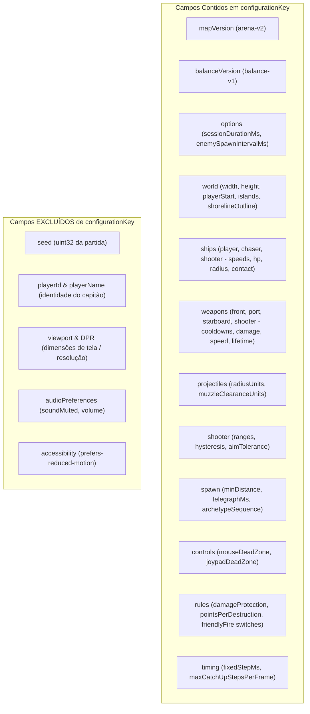

# Explore — implement-mock-rest-api (Incremento 10)

Concluído em 28/10/2026 por `/root/i10_explore`, operando estritamente em modo de análise e exploração técnica. Nenhuma alteração em código de produto, `openspec/changes/` ou `project/automation-state.json` foi efetuada.

---

## 1. Contexto e Diagnóstico da Base Atual

A base de código concluiu com sucesso o incremento 09 (`implement-battle-feedback`), dispondo de:
- Simulação determinística autoral pura a 60 Hz em TypeScript estrito (`src/simulation/`).
- Renderização avançada em PixiJS v8 (`src/render/`) com partículas de impacto, explosões, fumaça/fogo em estado crítico e muzzle flashes.
- Subsistema de áudio completo em Web Audio API (`src/audio/`) com voice-stealing polyphony e controle de mute.
- Controles híbridos completos para desktop (mouse + teclado) e mobile multitouch nativo com virtual joypad (`src/input/`).
- Armazenamento local defensivo versionado (`src/storage/local.ts`) para opções, identidade e último resultado (`last-result.v1`).
- Total de 261 testes unitários passando em Vitest (`npm test`) e suíte Playwright configurada para dev e preview.

### 1.1 Lacunas Identificadas para o Incremento 10 (GDD seções 12 e 13)
1. **Ausência de Camada de Rede e Cliente HTTP**:
   - Atualmente, não existem `axios` nem rotas de API implementadas.
   - No menu principal (`src/ui/App.tsx`), as opções de "Ranking" e "Match History" permanecem renderizadas como botões desabilitados com o texto explicativo: *"Ranking and Match History are not available yet."*
2. **Ausência de Mock Service Worker (MSW)**:
   - Não há infraestrutura de interceptação REST configurada nem para desenvolvimento (`vite dev`), nem para testes automatizados (`vitest`), nem para o build publicado (`vite preview` / `dist`).
   - O arquivo de worker `public/mockServiceWorker.js` não existe no repositório.
3. **Inexistência de Store Persistido de Partidas Confirmadas**:
   - Apenas o último resultado (`LOCAL_KEYS.result = 'pirate-battle.last-result.v1'`) é persistido localmente.
   - Não existe acervo ou coleção de partidas confirmadas que alimente simultaneamente o histórico de partidas do jogador e o ranking comparativo.
4. **Fixtures Determinísticas de Capitães Ausentes**:
   - Não há fixtures populadas para simular partidas de outros capitães com diferentes pontuações e datas passadas.
5. **Falta de Validação e Idempotência de Registro de Partidas**:
   - Não há endpoint `POST /api/matches` que valide a integridade do `CompletedMatchResult`, garanta idempotência estrita (mesmo payload com mesmo `matchId` retorna registro existente) e trate conflitos tipados (mesmo `matchId` com payload divergente retorna HTTP 409).

---

## 2. Inventário de Tecnologias e Compatibilidade de Dependências

### 2.1 Ambiente de Execução
- **Node.js**: `v26.11.1` (definido em `package.json` engines `>=26.0.0`)
- **npm**: `11.20.0`
- **React**: `19.3.1` / `@types/react`: `19.3.0`
- **Vite**: `8.3.5`
- **TypeScript**: `5.9.3`
- **Vitest**: `5.0.5`
- **Playwright**: `1.64.1`

### 2.2 Avaliação de Dependências Candidatas

| Dependência | Versão Alvo | Compatibilidade React 19 / Node 26 | Papel no Incremento 10 |
|---|---|---|---|
| `axios` | `^1.8.2` / `^1.21.0` | Total (compatível com ESM, Node 26 e browsers modernos) | Cliente HTTP tipado para consumo de endpoints `/api/*`. Fornece interceptors, cancelamento e timeouts explícitos. |
| `msw` | `^2.7.3` / `3.0.3` | Total (peerDependencies: Vite `>=6`, TypeScript `>=5.9`) | Interceptação mockada na camada de rede em desenvolvimento, testes (Node/Vitest) e build publicado (Service Worker). |
| `@tanstack/react-query` | `^5.66.0` | Total (peerDependencies: React `^18 \|\| ^19`) | Gerenciamento de cache remoto e estado assíncrono para as abas paginadas (planejado para os incrementos 11 e 12). |

> [!NOTE]
> Para o Incremento 10, o foco obrigatório é a fundação: `axios`, `msw` e os contratos/fixtures/store da API REST mockada. TanStack Query pode ser introduzido no incremento 11/12 ou instalado como fundação adiantada sem sobrecarregar o escopo atual.

### 2.3 Integração do MSW com Vite (Dev, Preview e Build)
O MSW opera em dois modos distintos:
1. **Ambiente Browser (`vite dev`, `vite preview` e produção)**:
   - Utiliza `setupWorker` de `msw/browser`.
   - Requer o script de Service Worker `mockServiceWorker.js` posicionado na pasta `public/`.
   - Durante `npm run build`, o Vite copia automaticamente todos os arquivos de `public/` para a raiz de saída `dist/`.
   - Portanto, ao executar `npm run preview` (porta 4173) ou ao realizar o deploy estático, `/mockServiceWorker.js` estará disponível na mesma URL base da aplicação.
2. **Ambiente Node (`vitest`)**:
   - Vitest roda sob ambiente `environment: 'node'` (conforme configurado em `vite.config.ts`).
   - Utiliza `setupServer` de `msw/node`, interceptando chamadas HTTP nativas do Node sem necessidade de Service Worker nem browser ativo.

---

## 3. Especificação Detalhada dos Contratos REST

Conforme definido nas seções 12 e 13 do GDD, os seguintes contratos REST SHALL ser atendidos:

### 3.1 `GET /api/ranking`
Consulta o ranking determinístico de partidas finalizadas para uma configuração específica.

- **Query Parameters**:
  - `configurationKey` (obrigatório, `string`): Chave canônica que identifica unicamente o conjunto de parâmetros que afetam o gameplay.
  - `page` (opcional, `integer`, default `1`): Página requisitada (1-based index).
  - `pageSize` (opcional, `integer`, default `10`, range `1..50`): Quantidade de itens por página.

- **Regras de Negócio e Ordenação**:
  - Filtra estritamente por partidas cujo `match.configurationKey === configurationKey`.
  - Ordenação determinística estrita:
    1. `score` decrescente (`b.score - a.score`).
    2. `completedAt` crescente (`a.completedAt.localeCompare(b.completedAt)`) — o jogador que alcançou a pontuação primeiro tem prioridade em caso de empate.
    3. `matchId` lexicográfico crescente (`a.matchId.localeCompare(b.matchId)`) — critério estável de desempate final.
  - Cada partida concluída possui sua própria entrada no ranking (não apenas o personal best do jogador).

- **Formato da Resposta (200 OK)**:
  ```json
  {
    "items": [
      {
        "matchId": "c3a1b7e0-4052-4e92-a1f7-2d88bb520930",
        "playerId": "a5029311-8841-4c12-92a0-43b91a27129f",
        "playerName": "Captain-7F3A",
        "completedAt": "2026-10-28T12:00:00.000Z",
        "score": 28,
        "activeDurationMs": 120000,
        "endReason": "time_expired",
        "configuration": { "..." : "..." },
        "configurationKey": "gameplay-v1:{...}",
        "seed": 104729
      }
    ],
    "page": 1,
    "pageSize": 10,
    "totalItems": 24
  }
  ```

- **Respostas de Erro**:
  - `400 Bad Request`: Se `configurationKey` for omitido ou inválido, ou se `page`/`pageSize` forem menores que 1.

---

### 3.2 `GET /api/players/:playerId/matches`
Consulta o histórico de partidas concluídas de um determinado jogador.

- **Path Parameters**:
  - `playerId` (obrigatório, `string`): Identificador UUID do jogador.

- **Query Parameters**:
  - `page` (opcional, `integer`, default `1`): Página requisitada.
  - `pageSize` (opcional, `integer`, default `10`): Itens por página.

- **Regras de Negócio e Ordenação**:
  - Filtra partidas cujo `match.playerId === playerId`.
  - Ordenação cronológica reversa:
    1. `completedAt` decrescente (`b.completedAt.localeCompare(a.completedAt)`).
    2. `matchId` lexicográfico crescente (`a.matchId.localeCompare(b.matchId)`).

- **Formato da Resposta (200 OK)**:
  ```json
  {
    "items": [ /* Lista paginada de CompletedMatchResult */ ],
    "page": 1,
    "pageSize": 10,
    "totalItems": 5
  }
  ```

- **Respostas de Erro**:
  - `400 Bad Request`: Se `playerId` estiver em branco ou parâmetros de paginação forem inválidos.

---

### 3.3 `POST /api/matches`
Registra atomicamente o resultado final e imutável de uma partida concluída.

- **Headers**:
  - `Content-Type: application/json`

- **Payload (`CompletedMatchResult`)**:
  - `matchId`: `string` UUID v4 (atua como chave de idempotência).
  - `playerId`: `string` UUID v4.
  - `playerName`: `string` (`Captain-XXXX`).
  - `completedAt`: `string` (formato ISO-8601 UTC estrito, ex: `2026-10-28T14:30:00.000Z`).
  - `score`: `integer` >= 0.
  - `activeDurationMs`: `number` >= 0 (excluindo pausas e carregamento).
  - `endReason`: `'player_destroyed' | 'time_expired'`.
  - `configuration`: `GameConfig` completo.
  - `configurationKey`: `string` canônica correspondente a `configuration`.
  - `seed`: `integer` uint32 (0 a 4.294.967.295).

- **Regras de Validação, Idempotência e Conflito**:
  1. **Validação Estrutural**:
     - O payload é submetido à validação rigorosa com base em `validateCompletedResult`. Dados corrompidos, tipos incorretos ou datas não-UTC resultam em `400 Bad Request`.
  2. **Registro Inédito (`matchId` não existe)**:
     - O registro é inserido no store persistente de partidas confirmadas.
     - Retorna `201 Created` com o snapshot imutável salvo.
  3. **Reenvio Idêntico (`matchId` já existe e payload é idêntico)**:
     - O store compara o registro gravado com o payload recebido (deep canonical equality).
     - Retorna `200 OK` (ou `201`) contendo o registro existente confirmado. Nenhuma duplicata é criada.
  4. **Conflito Tipado (`matchId` já existe, mas payload diverge)**:
     - Retorna `409 Conflict` com corpo tipado:
       ```json
       {
         "error": "Conflict",
         "message": "Match ID already exists with different payload.",
         "existingRecord": { "..." : "..." }
       }
       ```
  5. **Atomicidade e Visibilidade**:
     - O store é compartilhado entre ranking e histórico. Uma vez confirmado no POST, a nova partida torna-se imediatamente visível tanto em `GET /api/ranking` quanto em `GET /api/players/:playerId/matches`.

---

## 4. Persistência do Store Local de Matches

### 4.1 Isolamento e Separação de Dados
- **Separação Obrigatória**:
  - A partida ativa em andamento não interage com o store de partidas confirmadas. Dados voláteis de navegação, cooldowns e vida residem exclusivamente na memória da simulação.
  - O armazenamento local pré-existente possui a chave `pirate-battle.last-result.v1`, que retém apenas o último resultado exibível na tela "Last Result".
  - O store de partidas confirmadas mockadas utilizará uma chave dedicada e versionada:
    `pirate-battle.confirmed-matches.v1`.
- **Estrutura Envelope no LocalStorage**:
  ```json
  {
    "version": 1,
    "matches": [ /* array de CompletedMatchResult */ ]
  }
  ```
- **Fallback Resiliente em Memória**:
  - Em ambientes de teste (Node sem DOM) ou em navegadores com restrições de privacidade/cookies desabilitados (onde `window.localStorage` lança `SecurityError` ou `QuotaExceededError`), o store opera com um fallback transparente em memória RAM, garantindo que as chamadas de API nunca falhem por indisponibilidade de I/O local.

### 4.2 Fixtures Determinísticas de Capitães
Para popular o ranking inicial de forma realista e reproduzível:
- O sistema fornecerá uma coleção de 15 fixtures imutáveis de partidas (`CONFIRMED_MATCH_FIXTURES`), atribuídas a diferentes capitães fictícios (`Captain-9A1F`, `Captain-E420`, `Captain-18CB`, etc.).
- **Critérios de Modelagem das Fixtures**:
  - Configuração idêntica à configuração padrão (`DEFAULT_CONFIG` e sua respectiva `configurationKey`).
  - Pontuações distribuídas entre 0 e 32 pontos.
  - Timestamps UTC passados e ordenados temporalmente.
  - **Cenários Determinísticos de Teste embutidos**:
    - Pelo menos 2 capitães com a **mesma pontuação**, porém com `completedAt` diferente (para testar o desempate por quem completou antes).
    - Pelo menos 2 registros com a **mesma pontuação e mesmo timestamp**, com `matchId` lexicográfico distinto (para validar a ordenação estável por `matchId`).
- **Política de Injeção no Boot**:
  - Ao inicializar o store pela primeira vez: se a chave `pirate-battle.confirmed-matches.v1` estiver vazia ou ausente, o store é semeado com as fixtures determinísticas.
  - Se a chave já existir, o store restaura os dados existentes sem reinscrever nem duplicar as fixtures.
  - Cada fixture possui um `matchId` determinístico reservado (ex: `fixture-match-001` a `fixture-match-015`), garantindo verificação por chave única.

---

## 5. Cálculo Canônico de `configurationKey`

O GDD estabelece:
> *"Derive configurationKey from a canonical representation of all gameplay-affecting settings plus map and balance version. Exclude seed, player identity, display size, and accessibility/audio preferences. Ranking compares only identical configuration keys."*

### 5.1 Campos Participantes vs. Campos Excluídos



### 5.2 Implementação Existente e Garantias
A função `configurationKey(configuration: GameConfig)` em `src/domain/validation.ts` já implementa esse princípio com precisão matemática:
1. Serializa ordenando alfabeticamente todas as chaves de objetos de forma recursiva.
2. Preserva a ordem original de coleções e arrays semânticos.
3. Não utiliza hashing com perdas (MD5/SHA) para evitar colisões silenciosas.
4. Produz uma string canônica no formato: `gameplay-v1:{"balanceVersion":"balance-v1","controls":{...},"mapVersion":"arena-v2",...}`.
5. Como `seed` e `identity` residem fora de `GameConfig`, eles estão estruturalmente imunes a vazamento na chave.

---

## 6. Identidade Local do Jogador

### 6.1 Especificação da Identidade
- Conforme GDD seção 12:
  - Identidade do jogador consiste em:
    - `playerId`: string formatada como UUID v4 (`crypto.randomUUID()`).
    - `playerName`: codinome legível no padrão `Captain-XXXX`, onde `XXXX` são 4 dígitos hexadecimais em maiúsculas (derivados dos primeiros 4 caracteres do UUID).
- **Persistência**:
  - Salva sob `LOCAL_KEYS.identity` (`pirate-battle.identity.v1`).
  - No primeiro acesso, se a identidade não existir no `localStorage`, ela é gerada e salva. Em visitas subsequentes, a mesma identidade é recuperada.
  - Se o `localStorage` estiver indisponível, uma identidade de sessão é gerada em memória, permitindo jogar sem interrupções.
- **Isolamento de Escopo**:
  - A identidade e o ranking pertencem estritamente ao navegador do usuário.
  - A aplicação não deve anunciar nem simular um backend compartilhado entre diferentes navegadores ou clientes.

---

## 7. Arquitetura de Mocks e Inicialização no Frontend

### 7.1 Módulos Propostos na Camada `src/data` e `src/mocks`

```
src/
├── data/
│   ├── contracts.ts       # Interfaces TypeScript para requests, responses e erros da REST API
│   └── client.ts          # Instância Axios tipada com fetchRanking, fetchPlayerMatches, registerMatch
├── mocks/
│   ├── fixtures.ts        # 15 partidas determinísticas de outros capitães
│   ├── store.ts           # ConfirmedMatchStore persistido com LocalStorage e fallback em memória
│   ├── handlers.ts        # Handlers MSW (http.get /api/ranking, http.get /api/players/:id/matches, http.post /api/matches)
│   ├── browser.ts         # setupWorker para ambiente browser (dev, preview e build)
│   ├── server.ts          # setupServer para testes unitários/integração no Node (Vitest)
│   └── init.ts            # Boot assíncrono resiliente do MSW antes do mount do React
└── ...
public/
    └── mockServiceWorker.js   # Script oficial do MSW v2/v3 para interceptação via Service Worker
```

### 7.2 Boot Assíncrono do MSW no `src/main.tsx`
Para garantir o critério: *"MSW pronto antes de requests; falha no serviço não impede Play"*:
1. No `src/main.tsx`, antes de chamar `application.render(...)`, uma rotina assíncrona `startMockServiceWorker()` aguarda a ativação do Service Worker em ambiente de browser:
   ```ts
   async function startMockServiceWorker(): Promise<void> {
     if (typeof window !== 'undefined' && 'serviceWorker' in navigator) {
       try {
         const { worker } = await import('./mocks/browser');
         await worker.start({
           onUnhandledRequest: 'bypass',
           serviceWorker: {
             url: `${import.meta.env.BASE_URL}mockServiceWorker.js`,
           },
         });
       } catch (error) {
         console.warn('MSW worker failed to start; offline/local play remains available.', error);
       }
     }
   }
   ```
2. Caso a inicialização do Service Worker falhe (por exemplo, em iframes com permissões restritas, políticas corporativas ou HTTP não-localhost), a promessa captura o erro sem lançar exceção fatal, permitindo que a aplicação monte e funcione normalmente.

### 7.3 Suporte a Cenários Mockados (GDD seção 13)
O handler e store do MSW devem suportar alternância de cenários para testes automatizados e demonstrações (via query parameters como `?networkScenario=empty`, `?networkScenario=slow`, `?networkScenario=error`):
- `default`: Funcionamento normal com fixtures e partidas registradas.
- `empty`: Ranking e histórico vazios.
- `slow`: Latência artificial para validação de loading states.
- `error`: Simulação de falhas transitórias 500 / conexão.
- `reset`: Ação programática para restaurar as fixtures padrão sem afetar uma batalha em andamento.

---

## 8. Specs do OpenSpec Afetadas

Para manter o princípio spec-driven e a rastreabilidade total com o GDD:

1. **Nova Spec**: `openspec/specs/mock-rest-api/spec.md`
   - **Requirements**:
     - `Requirement: Contratos REST paginados para Ranking e Histórico` (cenários de paginação, filtros e ordenação determinística score DESC, completedAt ASC, matchId ASC).
     - `Requirement: Registro idempotente e resolução de conflitos em POST /api/matches` (cenários de criação inédita 201, reenvio idêntico 200/201 e conflito tipado 409).
     - `Requirement: Store persistido de partidas confirmadas e isolamento de sessão` (cenários de persistência após refresh, separação da partida ativa e fallback em memória).
     - `Requirement: Inicialização resiliente do MSW em dev, preview e testes` (cenários de interceptação Service Worker no browser, interceptação Node no Vitest e fallback sem bloqueio de Play).
     - `Requirement: Fixtures determinísticas e geração de identidade` (cenários de semeadura única sem duplicatas e identidade Captain-XXXX).

2. **Deltas / Sincronizações Complementares**:
   - `openspec/specs/simulation-contracts/spec.md`: Assegurar que `CompletedMatchResult` e `validateCompletedResult` continuem sendo o tipo canônico compartilhado entre simulação e API.
   - `openspec/specs/game-configuration/spec.md`: Manter explícito o isolamento de `configurationKey` em relação a seed e viewport.

---

## 9. Plano de Testes e Validação do Incremento 10

### 9.1 Testes Unitários em Vitest (`tests/mockStore.test.ts`)
- **Ordenação do Ranking**:
  - Partidas com scores diferentes ordenam do maior para o menor.
  - Partidas com mesmo score ordenam pela que terminou primeiro (`completedAt` menor).
  - Partidas com mesmo score e mesmo horário ordenam por ordem lexicográfica de `matchId`.
- **Paginação**:
  - `page=1, pageSize=5` retorna os primeiros 5 itens e `totalItems` correto.
  - `page=2` retorna os itens subsequentes sem sobreposição.
  - Páginas além do total retornam array vazio `items: []`.
- **Idempotência do POST**:
  - Enviar o mesmo payload duas vezes resulta em 1 único registro armazenado e respostas bem-sucedidas.
  - Enviar payload divergente com mesmo `matchId` retorna erro 409 tipado sem alterar o registro existente.
- **Histórico por Jogador**:
  - `GET /api/players/:playerId/matches` retorna apenas as partidas do jogador especificado, em ordem cronológica decrescente.

### 9.2 Testes de Integração com Axios + MSW Node (`tests/apiClient.test.ts`)
- Inicializar `setupServer` com os handlers do MSW.
- Executar chamadas reais com a instância configurada do `axios`:
  - `fetchRanking(configKey, 1, 10)`
  - `fetchPlayerMatches(playerId, 1, 10)`
  - `registerMatch(payload)`
- Validar tratamento de erros HTTP (400, 404, 409, 500) pelo cliente Axios.

### 9.3 Testes E2E com Playwright (`tests/e2e/mockApi.spec.ts`)
- Validar em `dev` e `preview` que o Service Worker registra sem erros de console.
- Verificar que refreshes da página preservam dados gravados no `localStorage`.
- Garantir que uma falha induzida no MSW não impede a inicialização nem o funcionamento do jogo ("falha no serviço não impede Play").

---

## 10. Recomendações para a Fase `propose`

1. **Change Name**: `implement-mock-rest-api`
2. **Dependências a Adicionar no `package.json`**:
   - `axios`: dependência de produção (`dependencies`).
   - `msw`: dependência de desenvolvimento/build (`devDependencies`).
3. **Arquivos a Criar**:
   - `public/mockServiceWorker.js`: Script padrão do MSW.
   - `src/data/contracts.ts`: Contratos e tipos de resposta REST.
   - `src/data/client.ts`: Cliente HTTP Axios tipado.
   - `src/mocks/fixtures.ts`: Fixtures determinísticas de capitães.
   - `src/mocks/store.ts`: Store persistente de partidas confirmadas.
   - `src/mocks/handlers.ts`: Handlers REST do MSW.
   - `src/mocks/browser.ts`: Instância do worker para o navegador.
   - `src/mocks/server.ts`: Instância do server para Vitest.
   - `src/mocks/init.ts`: Inicializador assíncrono tolerante a falhas.
   - `tests/mockApi.test.ts`: Testes rigorosos de contratos, ordenação e idempotência.
4. **Arquivos a Atualizar**:
   - `src/main.tsx`: Aguardar `initMocks()` antes do render.
   - `package.json`: Inclusão das dependências.
   - `ARCHITECTURE.md`: Atualizar seção de data layer e contratos REST.
   - `openspec/specs/mock-rest-api/spec.md`: Criação da especificação do OpenSpec.
